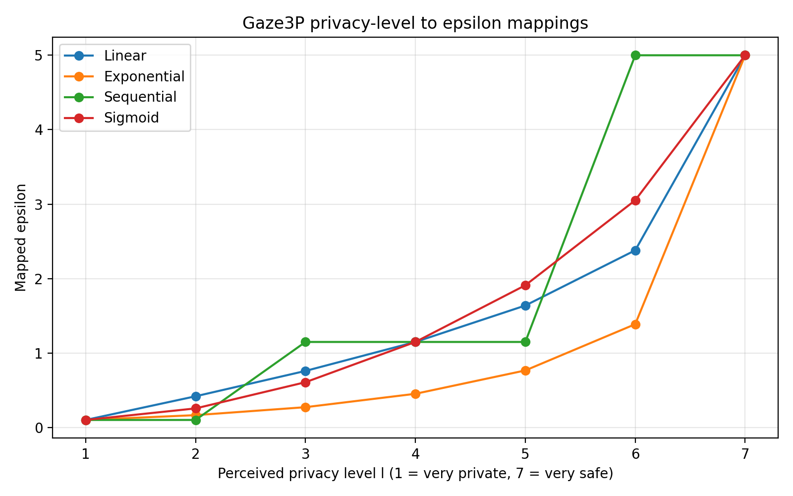
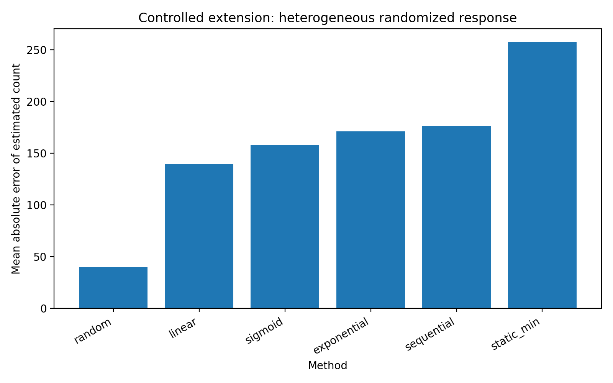
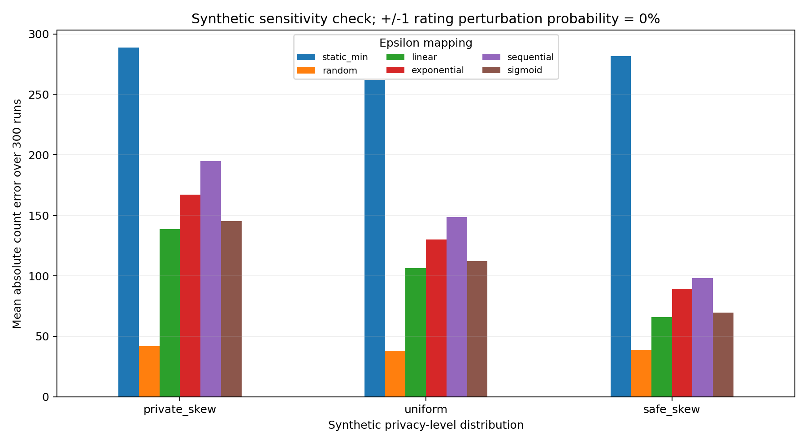
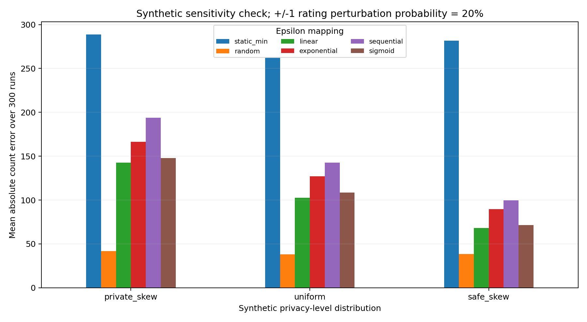

# Gaze3P — Critical Analysis, Reproduction & Synthetic Extension

[](https://www.python.org/)
[](#-data-provenance-read-this-first)
[](#-data-provenance-read-this-first)

A coursework project for **Data Privacy – Academic Paper Analysis**. It critically examines the paper
**Gaze3P: Gaze-Based Prediction of User-Perceived Privacy** and re-implements its four
*perceived-privacy → privacy-budget (ε)* mappings, then stress-tests them in a controlled
**synthetic** local-differential-privacy (LDP) setting.

> **Author:** Burak Bekir Çakırer · **Student ID:** 2211011008 · **Last revision:** 14 October 2026

---

## Table of contents

1. [Background](#background)
2. [What this repository contains](#what-this-repository-contains)
3. [Data provenance (read this first)](#-data-provenance-read-this-first)
4. [The four ε mappings](#the-four-ε-mappings)
5. [Experiments](#experiments)
6. [Quick start](#quick-start)
7. [Repository layout](#repository-layout)
8. [Working with the real Gaze3P data (optional)](#working-with-the-real-gaze3p-data-optional)
9. [Building the report](#building-the-report)
10. [Academic integrity & AI disclosure](#academic-integrity--ai-disclosure)
11. [Citation](#citation)

---

## Background

**Gaze3P** (Elfares, Reisert, Küsters & Bulling, 2025, [arXiv:2507.00596v2](https://arxiv.org/abs/2507.00596))
asks whether a person's *own* perception of how private an image is can be predicted from their
**eye movements**, and whether that prediction can then drive *personalized* differential privacy:
users who perceive content as more private receive a stronger guarantee (smaller ε).

The pipeline has two stages:

1. **Perception prediction** – gaze features (and optionally the viewed stimulus) are used to predict a
   user's privacy rating on a 7-point scale.
2. **Personalized DP** – the predicted rating is mapped to an individual privacy budget ε through
   one of four mapping functions (linear, exponential, sequential, sigmoid) bounded by
   `ε_min = 0.1` and `ε_max = 5.0`.

This repository focuses on stage 2 and on the **critical evaluation** of the whole approach: what the
mappings do numerically, how they behave when ratings are skewed or noisy, and what the original study
does *not* establish.

## What this repository contains

| Component | Description |
|---|---|
| **Critical-analysis report** | Typeset PDF, editable DOCX, and full LaTeX source (`report/`). |
| **Mapping implementations** | The four published ε mappings plus the adversarial-advantage transform `adv(ε) = tanh(ε/2)` and its inverse (`src/mappings.py`). |
| **Figure reproduction** | Plot of all four mappings across the 7 privacy levels (`src/reproduce_figure7.py`). |
| **Synthetic LDP experiment** | Heterogeneous binary randomized response with a debiased count estimator (`src/synthetic_ldp_experiment.py`). |
| **Sensitivity sweep** | Three rating distributions × two rating-perturbation levels × six ε-assignment methods (`src/extended_sensitivity_experiment.py`). |
| **Dataset summary helper** | Opt-in descriptive statistics for a CSV extract that *you* obtained legitimately (`src/dataset_ratings_summary.py`). |
| **Tests** | Unit tests for the mapping equations, endpoint values, and input validation (`tests/`). |
| **Documentation** | Experiment specification, AI-use disclosure, and a student-review checklist (`docs/`). |

## ⚠️ Data provenance (read this first)

**The participant-level Gaze3P dataset (100 participants) is *not* part of this repository and was
*not* analyzed.** Everything computed here is based on **synthetic** records.

- Numbers taken from the paper (e.g. classification accuracies) are stored in
  [`outputs/paper_reported_dataset_findings.csv`](outputs/paper_reported_dataset_findings.csv) and are
  labelled `original_paper_not_reproduced`.
- Numbers produced by the scripts in `src/` are **simulation results** and must not be read as
  findings about real participants, nor as a replication of the paper's personalized-DP benchmark.
- No participant gaze traces or stimulus images are stored here. Please do not commit any.

| Paper-reported observation | Value | Source |
|---|---|---|
| Person-independent SVM, binary perceived privacy | 0.64 accuracy | Table 1 |
| Person-specific Transformer | 0.81 accuracy | Table 1 |
| Gaze + stimuli Transformer | 0.97 accuracy | Table 1 |
| Privacy-expertise prediction (Random Forest) | 0.87 accuracy | Table 3 |
| Follow-up: mean privacy-expectation rating | 3.8 / 5 | Sec. 6.2 |
| Follow-up (N = 20): preference for sequential mapping | 68 % of cases | Sec. 6.2 |

## The four ε mappings

Each mapping converts a privacy level ℓ ∈ {1, …, 7} into ε, interpolating in *adversarial-advantage*
space `g = tanh(ε/2)` between `ε_min` and `ε_max`, then converting back with
`ε = ln((1+g)/(1−g))`.

| Level | Linear | Exponential | Sequential | Sigmoid (k = 1.5) |
|:---:|:---:|:---:|:---:|:---:|
| 1 | 0.100 | 0.100 | 0.100 | 0.100 |
| 2 | 0.418 | 0.165 | 0.100 | 0.255 |
| 3 | 0.759 | 0.272 | 1.148 | 0.607 |
| 4 | 1.148 | 0.452 | 1.148 | 1.148 |
| 5 | 1.638 | 0.765 | 1.148 | 1.910 |
| 6 | 2.380 | 1.387 | 5.000 | 3.052 |
| 7 | 5.000 | 5.000 | 5.000 | 5.000 |

*Full-precision values:* [`outputs/epsilon_mappings.csv`](outputs/epsilon_mappings.csv)



## Experiments

### 1 · Base synthetic LDP experiment

- 1,200 simulated users, 300 runs, prevalence 0.35, seed 42.
- Seven-level rating distribution `[0.25, 0.20, 0.18, 0.15, 0.10, 0.07, 0.05]` (deliberately private-skewed,
  **not** taken from Gaze3P).
- Each user holds a sensitive bit and reports it via **binary randomized response** with their own ε.
- **Utility metric:** absolute error of the debiased count estimator.

Compared strategies: static minimum ε, uniformly random ε, and the four mappings.

| Method | Mean abs. error | Mean ε |
|---|---:|---:|
| random | 40.3 | 2.548 |
| linear | 139.4 | 0.996 |
| sigmoid | 157.9 | 1.010 |
| exponential | 171.2 | 0.597 |
| sequential | 176.5 | 1.135 |
| static_min | 257.8 | 0.100 |



### 2 · Extended sensitivity sweep

- 1,200 users, 300 runs per condition, seed 20261014.
- **Three hypothetical rating distributions:** private-skewed, uniform, safe-skewed.
- **Rating perturbation:** none, or a 20 % probability of an attempted ±1 change (clipped to [1, 7], so the
  realized fraction of changed ratings is lower than 20 %).
- **Six methods:** static minimum, random, linear, exponential, sequential, sigmoid.
- Methods are compared on paired inputs and paired random draws within each run.
- **Reported metrics:** mean/median absolute count error, mean/median assigned ε, fraction of users whose ε
  *increased* because of a perturbed rating, and 95 % CI half-width of the error.

This is an **ε-assignment diagnostic**, not a measured formal DP violation, and it involves no gaze
classifier.

| 0 % perturbation | 20 % perturbation |
|:---:|:---:|
|  |  |

Tables: [`extended_sensitivity_summary.csv`](outputs/extended_sensitivity_summary.csv) ·
[`extended_sensitivity_raw.csv`](outputs/extended_sensitivity_raw.csv)

Full specification: [`docs/REPRODUCTION_NOTES.md`](docs/REPRODUCTION_NOTES.md).

### What these experiments do **not** show

- They do not measure gaze-based prediction quality; the paper's accuracies are **not** regenerated.
- They do not use real participant ratings or the paper's personalized-DP benchmark.
- They cannot be generalized to the real Gaze3P population without the real data.

## Quick start

Requires **Python 3.10+**.

```bash
# 1. (optional) create a virtual environment
python -m venv .venv
source .venv/bin/activate          # Windows: .venv\Scripts\activate

# 2. install dependencies
python -m pip install -r requirements.txt

# 3. regenerate every table and plot into outputs/
python run_all.py

# 4. run the tests
python -m unittest discover -s tests -v
```

Dependencies: `numpy`, `pandas`, `matplotlib`.

## Repository layout

```
gaze3p-critical-analysis-reproduction/
├── README.md
├── CITATION.cff
├── requirements.txt
├── run_all.py                  # runs all three experiment scripts
├── src/
│   ├── mappings.py             # adv(ε), inverse, and the four ε mappings
│   ├── reproduce_figure7.py    # mapping table + figure
│   ├── synthetic_ldp_experiment.py
│   ├── extended_sensitivity_experiment.py
│   └── dataset_ratings_summary.py
├── tests/
│   └── test_reproduction.py
├── outputs/                    # generated CSVs and plots
├── report/
│   ├── main.tex                # LaTeX source (XeLaTeX)
│   ├── figures/
│   ├── Gaze3P_Critical_Analysis_Final_Burak_Bekir_Cakirer.pdf
│   └── Gaze3P_Critical_Analysis_Final_Burak_Bekir_Cakirer.docx
├── paper/
│   └── README.md               # paper and dataset provenance
└── docs/
    ├── REPRODUCTION_NOTES.md
    ├── STUDENT_REVIEW_REQUIRED.md
    └── AI_USAGE_DISCLOSURE.md
```

## Working with the real Gaze3P data (optional)

The authors publish the dataset at the [Gaze3P data page](https://www.collaborative-ai.org/research/datasets/Gaze3P/)
and as a [Zenodo artifact](https://doi.org/10.5281/zenodo.17104154). **Check the permitted uses before
downloading**, and never commit participant records or large image files to this repository.

For a CSV extract with privacy ratings 1–7:

```bash
python src/dataset_ratings_summary.py --input /path/to/extract.csv --rating-col RATING_COLUMN
# optional group-level statistics
python src/dataset_ratings_summary.py --input /path/to/extract.csv --rating-col RATING_COLUMN --group-col GROUP_COLUMN
```

The real file schema is **not assumed** — inspect the original files and pass the correct column names.

## Building the report

1. Upload the project (or just `report/`) to a new [Overleaf](https://www.overleaf.com/) project.
2. Set **`report/main.tex`** as the *Main document*.
3. Choose **XeLaTeX** as the compiler.
4. Keep `report/figures/` next to `main.tex`.

The LaTeX source, DOCX, and PDF contain the same written material.

## Academic integrity & AI disclosure

The course prohibits generative AI from writing substantive critical interpretation. Accordingly:

- The student's original Section 5 critical analysis is preserved as submitted.
- Added material is limited to source-attributed paper facts, documented procedures, code, and
  machine-computed results.
- Student-written interpretation of the new results is still tracked in
  [`docs/STUDENT_REVIEW_REQUIRED.md`](docs/STUDENT_REVIEW_REQUIRED.md).
- Tool usage is documented in [`docs/AI_USAGE_DISCLOSURE.md`](docs/AI_USAGE_DISCLOSURE.md).

## Citation

If you reference this repository, please also cite the assigned paper:

> Elfares, M., Reisert, P., Küsters, R., & Bulling, A. (2025). *Gaze3P: Gaze-Based Prediction of
> User-Perceived Privacy*. arXiv:2507.00596. https://arxiv.org/abs/2507.00596

Repository metadata is available in [`CITATION.cff`](CITATION.cff).
